# sky：話すだけで日記が残る、スマートグラス × Gemini Live アプリ

> ディスプレイ付きスマートグラスで見ている景色を AI と共有しながら会話すると、その日の出来事と気持ちが記録され、夜には日記にまとまる Android アプリです。


**開発形態**: 企業主催ハッカソン、3人チーム（私はフロントエンド担当）　｜　**開発期間**: 2026年、約1カ月　｜　**結果**: 全13チーム中3位  
**デモ**: 公開デプロイなし（Android アプリのため）。下のスクリーンショットと[セットアップ手順](#セットアップ実行手順)を参照してください。

---

## 目次

- [概要](#概要)
- [画面](#画面)
- [制作背景・課題意識](#制作背景課題意識)
- [ターゲットユーザー](#ターゲットユーザー)
- [主な機能](#主な機能)
- [技術スタックと選定理由](#技術スタックと選定理由)
- [アーキテクチャ](#アーキテクチャ)
- [設計（MVVM）](#設計mvvm)
- [ディレクトリ構成](#ディレクトリ構成)
- [セットアップ・実行手順](#セットアップ実行手順)
- [使い方](#使い方)
- [工夫した点・技術的チャレンジ](#工夫した点技術的チャレンジ)
- [設計判断（やったこと／やらなかったこと）](#設計判断やったことやらなかったこと)
- [テスト](#テスト)
- [セキュリティ・プライバシー](#セキュリティプライバシー)
- [担当範囲](#担当範囲)
- [学習・参考資料・AI利用](#学習参考資料ai利用)
- [今後の改善予定](#今後の改善予定)
- [既知の制約](#既知の制約)
- [ライセンス](#ライセンス)
- [著者](#著者)

---

## 概要

スマートグラスのカメラ映像と自分の声を Gemini Live に送り、AI とリアルタイムで会話するアプリです。会話のやり取りと撮影した写真はその日の「記録」として端末に自動保存され、ボタン1つで日記にまとめられます。生成した日記には、AI が判定したポジティブ／ネガティブの割合も表示されます。

- **解決する課題**: 技術メモは毎日残せても、そのときの気持ちや「なぜそれをやったか」は書く手間がかかって残らず、あとから思い出せない
- **できること（現時点）**: グラスとの接続、カメラ映像の表示と撮影、Gemini Live との音声会話（映像も共有）、会話と写真の自動記録、日記と感情バランスの生成、日付ごとの振り返り
- **未実装・制約**: [今後の改善予定](#今後の改善予定) と [既知の制約](#既知の制約) を参照

---

## 画面

Android エミュレータ（Pixel 3 / Android 17 beta）で撮影しました。グラスの実機の代わりに、Meta の SDK に含まれる **MockDeviceKit** で仮想のグラスを接続しています。カメラ映像は、エミュレータが用意している仮想カメラの映像です。

> **注記**: 撮影時は Gemini API キーが無効だったため、③の会話テキストと⑤⑥の記録・日記の文章は、**アプリと同じ形式で用意したサンプルデータ**を表示しています。⑤の写真は、実際にアプリで撮影して保存したものです。

| ① 起動直後（LIVE タブ） | ② グラス接続後 | ③ Gemini と会話中 |
|:---:|:---:|:---:|
| 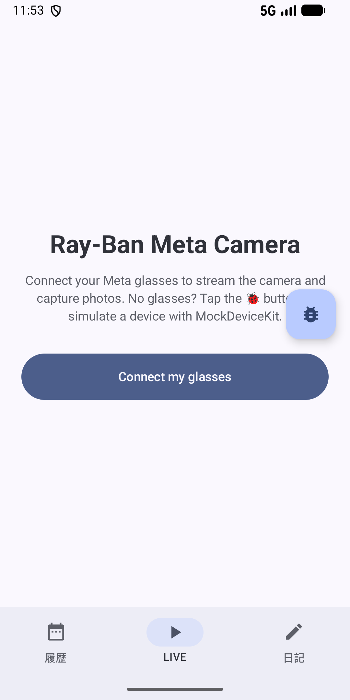 | 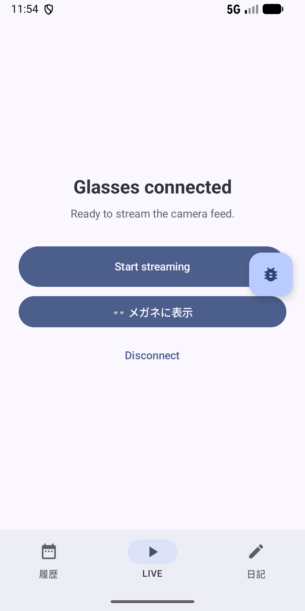 | 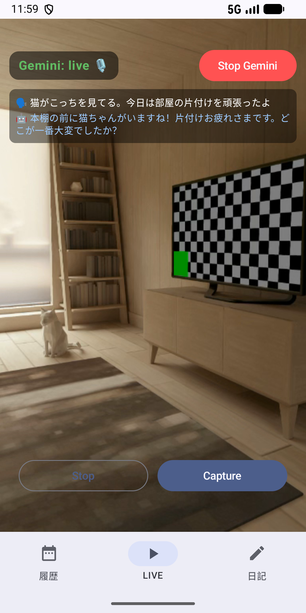 |
| グラス未接続時の画面。🐞 ボタンから仮想グラスを用意できます | 接続すると映像の取得と、メガネのディスプレイへの表示ができます | 映像の上に、自分の発話（🗣️）と AI の返答（🤖）を重ねて表示します |

| ④ MockDeviceKit（開発用） | ⑤ 履歴タブ | ⑥ 日記タブ |
|:---:|:---:|:---:|
| 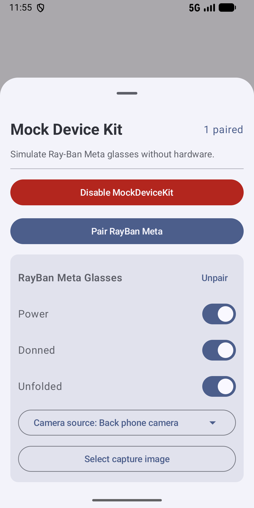 | 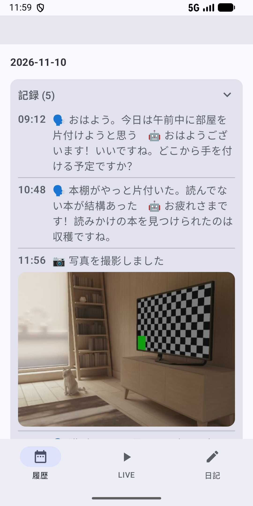 | 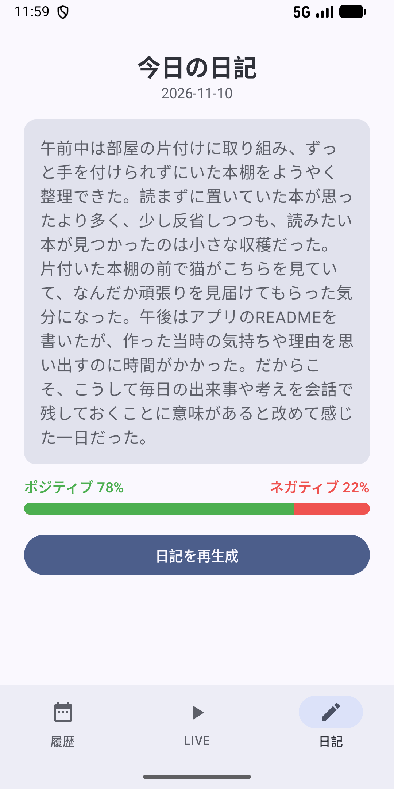 |
| 電源、装着、カメラの入力元を切り替えて、実機なしで動作を確かめられます | カレンダーで日付を選ぶと、その日の会話記録と写真を見られます | 今日の記録から日記を生成し、感情のバランスと一緒に表示します |

### 3D キャラクター「BLOOM」（チームメンバー制作）

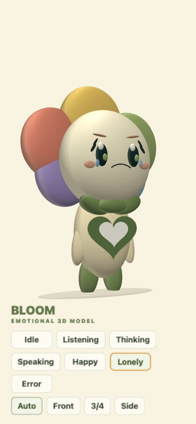

会話相手のキャラクターです。待機、聞き取り中、考え中、発話中、喜び、寂しさ、エラーの7つの状態があり、メンバーが外部ライブラリを使わない WebGL で制作しました。アプリには `WebView` で背景を透過させて埋め込み、AI が話している間は表情が切り替わるようにしています（`ui/BloomAvatar.kt`）。ただし、カメラ映像の上に重ねるとキャラクターが見えなくなる問題が解決できず、現在は表示を止めています（[既知の制約](#既知の制約)）。

---

## 制作背景・課題意識

### なぜ作ったか

個人開発でアプリを1年ほど作っていたとき、その日に学んだ技術的なことは毎日メモしていました。しかし、あとから読み返すと、**そのとき何を感じたのか、なぜその作業をしたのかが残っておらず、思い出せません**でした。気持ちまで文章で書き残すのは手間がかかり、続きませんでした。

そこで、「書く」代わりに「話す」だけで記録が残れば続けられるのではと考えました。スマートフォンだと、端末を取り出して入力する手間が残ります。スマートグラスなら、目の前の景色を AI と共有しながら、その場で話すだけで記録できます。

### 課題の整理

| 現状の不便 | 理想の状態 | 本アプリでの対応 |
|------------|------------|------------------|
| 気持ちや理由まで文章で書くのが面倒で続かない | 書かなくても記録が残る | AI と会話するだけで、やり取りが自動で記録に残る |
| スマホを取り出して入力するのが手間 | その場で、手を使わずに残せる | グラスのカメラ映像と音声で会話し、撮影も1タップ |
| 記録が散らばっていて振り返りにくい | 1日分がまとまっていて見返せる | 1日の記録を日記に要約し、日付ごとに見返せる |

### 成功の定義（チームで決めた完成ライン）

- [x] グラスの映像と音声を Gemini Live に送り、返答を音声と文字で返せる
- [x] 会話が自動で記録され、日記として生成・閲覧できる
- [x] 期限内に、ハッカソンのデモで一連の流れを実際に動かして見せられる

---

## ターゲットユーザー

- **想定利用者**: 日々の出来事や考えを残したいが、日記を書く習慣が続かない人（まずは自分自身）
- **利用シーン**: 出かけた先や作業中に、見ているものについて AI と話す。夜にその日の日記を読み返す
- **非対象**: 業務記録や議事録のような、正確さが求められる記録

> 実際のユーザーはいません。ハッカソンで作ったプロトタイプです。

---

## 主な機能

### 実装済み

| 優先度 | 機能 | できること | 状態 |
|--------|------|------------|------|
| P0 | グラス接続 | Meta AI アプリ経由でグラスを登録し、接続状態とファームウェア更新の要否を表示する | 完成 |
| P0 | カメラ映像 | グラスのカメラ映像（15fps）をスマートフォンに表示する | 完成 |
| P0 | Gemini Live との会話 | マイク音声と約1秒ごとのカメラ映像を送り、AI の返答を音声で再生し、文字でも表示する | 完成 |
| P0 | 自動記録 | 1往復の会話ごとに、時刻つきでその日の記録に追加する | 完成 |
| P0 | 日記生成 | その日の記録から、200〜400字の振り返り日記を生成する | 完成 |
| P1 | 写真撮影 | グラスで撮った写真を保存して記録に添付し、共有もできる | 完成 |
| P1 | 感情バランス | 日記のポジティブ度を 0〜100 で判定し、バーで表示する | 完成 |
| P1 | 履歴 | カレンダーで日付を選び、その日の記録と日記を見返す | 完成 |
| P2 | メガネへの表示 | ディスプレイ付きグラスに、接続確認用のカードを表示する | 一部（固定のカードのみ） |
| P2 | 図形問題のヒント（メンバー担当） | 映っている図形問題を検出し、段階的なヒントを音声と文字で出す | 完成（図の描画は外部の表示側に任せる） |

### 今回やらない機能（スコープ外）

- **アカウント・クラウド同期**: 1台の端末で使うデモが目的のため、端末内の保存のみ
- **日記の編集**: 自動で残すことが価値なので、まずは生成と閲覧に絞った
- **iOS 版**: SDK は Swift 版もあるが、期間内に1つのプラットフォームで完成させることを優先した

---

## 技術スタックと選定理由

### 一覧

| 分類 | 技術 | バージョン | 役割 |
|------|------|------------|------|
| 言語 | Kotlin | 2.2.10 | アプリ全体 |
| UI | Jetpack Compose（Material 3） | Compose BOM 2024.09.00 | 全画面の UI |
| 状態管理 | ViewModel + `StateFlow` | lifecycle 2.8.7 | 画面状態の保持と更新 |
| グラス連携 | Meta Wearables Device Access Toolkit（`mwdat-core` / `camera` / `display` / `mockdevice`） | 0.7.0 | 接続、カメラ映像、撮影、メガネへの表示、仮想グラス |
| AI（会話） | Gemini Live API（WebSocket、`gemini-3.1-flash-live-preview`） | — | 音声と映像によるリアルタイム会話 |
| AI（日記） | Gemini API（REST、`gemini-3-flash-preview`） | — | 日記の要約、感情判定（関数呼び出し） |
| 通信 | OkHttp | 4.12.0 | WebSocket と REST |
| 音声 | `AudioRecord` / `AudioTrack` | Android 標準 | 16kHz で録音、24kHz で再生 |
| 保存 | SharedPreferences（JSON）+ 内部ストレージ | Android 標準 | 記録・日記・写真 |
| ビルド | Android Gradle Plugin / Gradle | 9.1.1 / 9.3.1 | — |

### 選定理由

| 技術 | なぜ選んだか | 検討して見送った候補 |
|------|--------------|----------------------|
| Kotlin | Meta のグラス向け SDK が Android では Kotlin を前提にしていたため | **Flutter**（最初はこれで作ったが、約1週間試してもグラスと連携できなかった） |
| Jetpack Compose | 状態が変わると画面が自動で更新されるので、接続状態や会話の途中経過のように頻繁に変わる表示を少ないコードで書ける | XML レイアウト |
| Gemini Live API | 音声と映像を同時に送れて、返事も音声で返ってくるので、「見ているものについて話す」体験をそのまま作れる | 音声認識 → テキスト生成 → 読み上げをつなぐ構成（遅延が大きく、映像を共有できない） |
| SharedPreferences（JSON） | 保存するのは日付ごとの記録と日記だけで、検索なども必要なかったため。DB を設計する時間を機能に回した | Room |

---

## アーキテクチャ

### 全体像

グラスのカメラ映像と音声をスマートフォンで受け取り、Gemini Live に送ります。返ってきた音声は再生し、文字起こしは画面に表示したうえで、端末内の記録に保存します。日記は、保存した記録を Gemini API に渡して生成します。

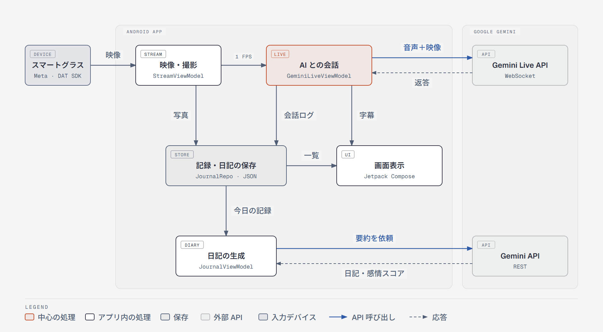

図では省略していますが、ほかに次の処理があります。

- 音声の入出力は `MicRecorder`（16kHz で録音）と `SpeakerPlayer`（24kHz で再生）が担当
- `DisplayViewModel` がメガネのディスプレイに表示カードを送る
- 設定した場合のみ、`RelayPublisher` が会話の状態とヒントを外部の WebSocket リレーに送る

### 会話から記録までの流れ（シーケンス図）

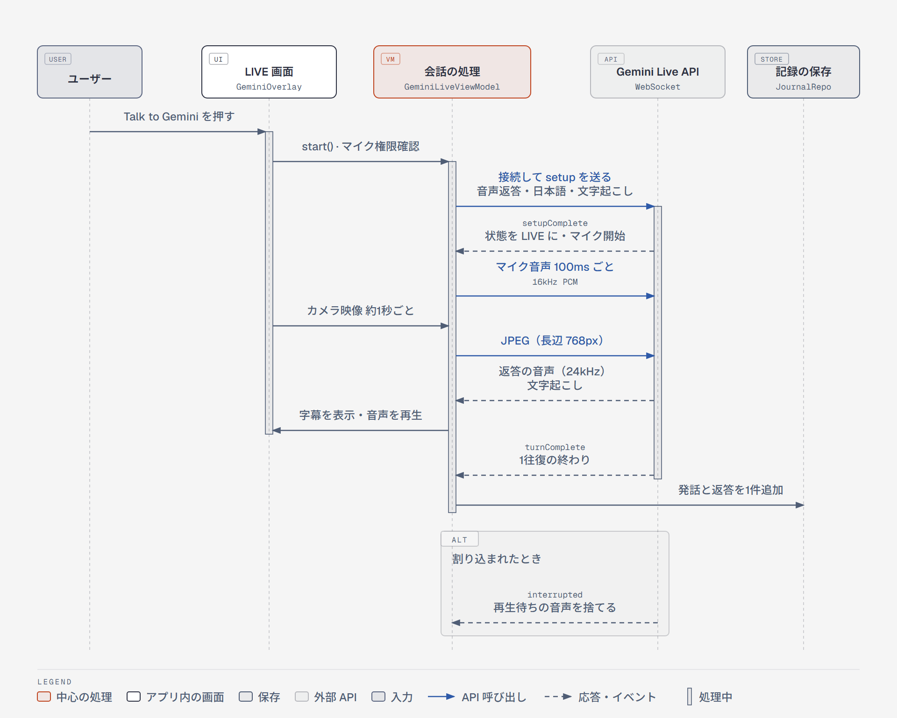

1往復が終わるたびに、`🗣️ 発話　🤖 返答` の形でその日の記録に追加します。ユーザーが話し始めて AI の発話が中断されたとき（`interrupted`）は、再生待ちの音声を捨てます。

### 映像の表示と日記の生成

1. 「Start streaming」を押すと、DAT SDK でグラスとのセッションを開き、カメラ映像（I420）を Bitmap に変換して表示する
2. 日記タブで生成を押すと、その日の記録を Gemini API に送って日記を生成し、続けて関数呼び出しで感情スコア（0〜100）を受け取って保存する

### 状態の移り変わり

**LIVE タブの画面**（`GlassesApp.kt`。`WearablesUiState` の値で切り替わる）

| 画面 | 表示される条件 | 次へ進む操作・戻る条件 |
|------|----------------|------------------------|
| `HomeScreen` | グラスが未登録 | 「Connect my glasses」で、Meta AI アプリを通してグラスを登録する |
| `NonStreamScreen` | 登録済み・映像なし | 「Start streaming」でカメラ権限を確認してから映像を開始する。「Disconnect」で登録を解除する |
| `StreamScreen` | 映像を受信中 | 「Stop」で前の画面に戻る。セッションが終了・エラーになったときも自動で戻り、エラー内容を表示する |

**図形ヒント機能**（メンバー担当。`GeminiLiveViewModel` の `TutorPhase`）

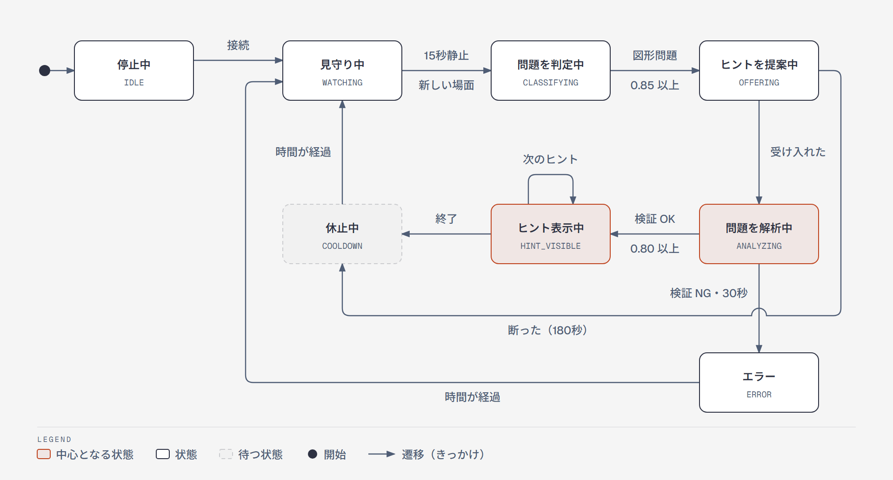

図を見やすくするため、次の2つは矢印を省いています。

- 判定の結果が対象外だったとき、提案中に場面が変わったときは「見守り中」に戻る
- 「Stop Gemini」を押すと、どの状態からも「停止中」に戻る

### データモデル

記録と日記は、日付ごとの `DayEntry` を1つの JSON にまとめて SharedPreferences に保存し、写真は JPEG ファイルとして内部ストレージに保存します。

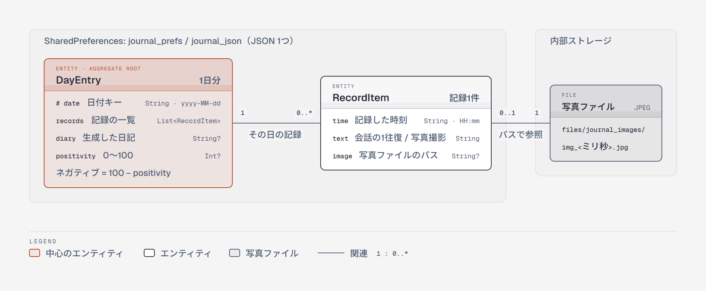

図の元データは `docs/diagrams/` にあります。

---

## 設計（MVVM）

Android が推奨する「UI 層 ＋ ViewModel」の構成に合わせた **MVVM** です。データは「画面の操作 → ViewModel の関数 → `StateFlow` の更新 → 画面の再描画」と一方向に流れます。

| 層 | 実際のコード | 役割 |
|----|--------------|------|
| View | `ui/*.kt`（Jetpack Compose） | `StateFlow` を `collectAsStateWithLifecycle()` で受け取って描画し、操作は ViewModel の関数を呼ぶだけにする |
| ViewModel | `WearablesViewModel`、`StreamViewModel`、`GeminiLiveViewModel`、`JournalViewModel`、`DisplayViewModel`、`MockDeviceKitViewModel` | 画面の状態を `MutableStateFlow` で持ち、`StateFlow` として公開する。非同期処理は `viewModelScope` で行う |
| 状態 | `GeminiUiState`、`StreamUiState`、`WearablesUiState`、`DiaryUiState` など | 画面に出す値をまとめた data class。接続中・エラーなどの状態もここで表す |
| Model | `JournalRepo`、`GeminiLiveClient`、`GeminiTextClient`、`MicRecorder` / `SpeakerPlayer`、`RelayPublisher` | 保存、通信、音声の入出力 |

### MVVM にした理由

- **Compose は状態から画面を作る仕組みなので、状態の置き場所を ViewModel に固定すると役割が分かれる。** 画面側は「状態を描く」「操作を伝える」だけになる
- **通信やマイクの寿命を、画面ではなく ViewModel に持たせられる。** 画面の回転などで Composable が作り直されても接続は切れず、ViewModel が破棄されるとき（`onCleared`）に `stop()` でマイクと WebSocket を確実に閉じている
- **状態を data class にまとめると、画面が出し分けるべきパターン（off / connecting / live / error など）がはっきりする**

### 今の課題（ハッカソンで後回しにした部分）

- **`GeminiLiveViewModel` に責任が集中している（577 行）。** 接続、マイク・スピーカー、外部リレー、図形ヒント、場面の変化の検出、記録の保存を1つのクラスが持っている
- **ViewModel が通信クライアントを直接作っている。** `GeminiLiveClient(...)` を中で生成しているため、テストのときに偽物へ差し替えられない。DI（Hilt など）は使っていない
- **ViewModel が別の ViewModel に依存している。** `StreamViewModel` がコンストラクタで `WearablesViewModel` を受け取っている
- **`JournalRepo` がアプリ全体で1つの `object`。** `StreamViewModel` と `GeminiLiveViewModel` からも直接 `addRecord()` を呼んでいて、依存関係がコードの中に隠れている
- **ViewModel を画面の奥で取得している。** `GeminiOverlay` と `DisplayPanel` が自分の中で `viewModel()` を呼ぶため、プレビューや画面単体のテストがしにくい

実用化するなら、通信と保存を Repository（インターフェース）に分けて Hilt で渡し、`GeminiLiveViewModel` を「会話」と「図形ヒント」に分割します。依存の向きは「View → ViewModel → Repository」の一方向にそろえます。

---

## ディレクトリ構成

```text
sky/
├── README.md
├── docs/
│   ├── images/                       # README 用のスクリーンショットと図（PNG）
│   └── diagrams/                     # 図の元データ（HTML。diagram-design で作成）
├── gradle/libs.versions.toml         # 依存ライブラリのバージョン
├── settings.gradle.kts               # Meta SDK の取得先（GitHub Packages）
└── app/
    ├── build.gradle.kts              # API キーを BuildConfig に注入
    └── src/
        ├── main/
        │   ├── AndroidManifest.xml
        │   ├── assets/bloom-3d-companion/  # 3D キャラクター（WebGL）
        │   └── java/com/example/myapplication/
        │       ├── MainActivity.kt         # 権限の要求、SDK の初期化
        │       ├── ui/                     # Compose の画面（タブ、LIVE、履歴、日記など）
        │       ├── wearables/              # グラスの登録・接続状態
        │       ├── stream/                 # カメラ映像、撮影
        │       ├── display/                # メガネのディスプレイへの表示
        │       ├── gemini/                 # Gemini Live、音声の入出力、外部リレー
        │       ├── journal/                # 記録・日記の保存、日記生成
        │       ├── tutor/                  # 図形問題のヒント（メンバー担当）
        │       └── mockdevicekit/          # 仮想グラスの操作
        └── test/                           # 単体テスト
```

---

## セットアップ・実行手順

> **動作確認日**: 2026-11-10　／　**確認環境**: Windows 11、JDK 21、Android Emulator（Pixel 3、Android 17 beta）  
> Gradle のキャッシュがある環境でビルドとインストールを確認しました。まっさらな環境と、グラスの実機では今回は確認していません。

### 必要なもの

- Android Studio（AGP 9.1 に対応する版）と JDK 17 以上
- Android 12（API 31）以上の端末またはエミュレータ
- `read:packages` 権限のある GitHub の Personal Access Token（Meta の SDK を GitHub Packages から取得するため）
- Gemini API キー（会話と日記生成に使用。[Google AI Studio](https://aistudio.google.com/) で発行）
- （任意）Meta のスマートグラスと Meta AI アプリ。なくても MockDeviceKit で動かせます

### 1. クローン

```bash
git clone https://github.com/kazuki-N5/sky.git
cd sky
```

### 2. `local.properties` に設定を追加

プロジェクト直下の `local.properties`（Git 管理外）に次を追加します。**実際の値はコミットしないでください。**

```properties
# Meta Wearables DAT SDK を取得するためのトークン（環境変数 GITHUB_TOKEN でも可）
github_token=ghp_xxxxxxxxxxxxxxxxxxxx
# Gemini API キー
gemini_api_key=your-gemini-api-key
# （任意）会話の状態を送る WebSocket リレー。空なら送信しない
relay_ws_url=
```

### 3. ビルドして起動

```bash
./gradlew assembleDebug          # Windows は gradlew.bat
adb install -r app/build/outputs/apk/debug/app-debug.apk
```

Android Studio で開いて `app` を実行しても構いません。

### よくあるつまずき

| 症状 | 確認すること |
|------|--------------|
| `mwdat-*` の依存関係が取得できない | `github_token` が設定されているか、`read:packages` 権限があるか |
| 「Gemini: error」と `API key not valid` が出る | `gemini_api_key` が有効か。変更したら再ビルドが必要（`BuildConfig` に埋め込むため） |
| 「Start streaming」で「メガネ側アプリの更新が必要です」と出る | MockDeviceKit で `Donned`（装着）と `Unfolded`（展開）が ON になっているか。OFF のまま開始すると、セッションが拒否されてこの表示になる |

---

## 使い方

### グラスがない場合（MockDeviceKit）

1. LIVE タブの 🐞 ボタンを押し、「Enable MockDeviceKit」→「Pair RayBan Meta」を押す
2. 「Power」と「Donned」を ON にし（Donned を ON にすると Unfolded も ON になる）、「Camera source」で端末のカメラを選ぶ
3. パネルを閉じると「Glasses connected」と表示されるので、「Start streaming」を押す

### 会話から日記まで

1. 映像が出たら「Talk to Gemini」を押し、マイクを許可して話しかける。映像の上に会話の文字が出る
2. 「Capture」で写真を撮ると、その日の記録に写真が追加される
3. 「日記」タブで「今日の日記を生成」を押すと、日記と感情バーが表示される
4. 「履歴」タブで日付を選ぶと、その日の記録と日記を見返せる

うまくいかないときの表示:

- API キーが未設定か無効 → 映像の上に赤い帯でエラーを表示
- 記録がない日に日記を生成 → 「今日の記録がまだありません」と表示
- グラスのファームウェアやアプリの更新が必要 → 黄色の案内と更新ボタンを表示

---

## 工夫した点・技術的チャレンジ

### 1. グラスと連携できない Flutter をやめ、Kotlin で作り直した

- **問題**: 使い慣れた Flutter でフロントエンドとバックエンドの両方を作っていたが、約1週間試してもグラスと正常に連携できなかった。並行して、AI にコード変更を任せる中で必要なコードの上書きやコンフリクトが何度も起き、計画が遅れていた
- **原因・切り分け**: Meta の SDK は Kotlin と Swift 向けにしか提供されておらず、Flutter からは公式の手順で使えなかった。コンフリクトは、1人が画面と内部処理の両方を触っていて、変更の範囲が重なっていたことが原因だった
- **判断**: 残り約2週間の時点で、Flutter で粘るより公式に対応している Kotlin に移る方が期限内に完成できると判断した
- **対応**: 移行と同時にチームの役割を見直し、バックエンドをメンバーに任せて、自分は Jetpack Compose の画面に専念した
- **結果**: 担当範囲が分かれてコードの上書きやコンフリクトがなくなり、映像と音声の送信、会話、記録、日記の生成と閲覧まで、一連の流れが動くプロトタイプを期限内に完成させた

### 2. 実機がなくても開発・確認できるようにした

- **問題**: グラスの実機はチームで限られていて、誰でもいつでも試せるわけではなかった
- **原因・切り分け**: SDK には実機なしでグラスを再現する MockDeviceKit があり、Meta のサンプルアプリ（CameraAccess）にその操作部分の実装があった
- **対応**: サンプルの MockDeviceKit の操作部分を取り込み、LIVE 画面の 🐞 ボタンから開けるパネルとして組み込んだ。電源、装着、折りたたみ、カメラの入力元（端末のカメラ、動画、画像）を画面から切り替えられる
- **結果**: エミュレータだけで、接続から映像表示、撮影、記録までを確認できる（このREADMEのスクリーンショットもこの方法で撮影）

### 3. 会話の途中経過と待ち時間を、映像の上で分かるようにした

- **問題**: グラス越しの会話は、AI が聞き取っているのか、つながっていないのかが分かりにくい
- **原因・切り分け**: Gemini Live の接続には「接続中」「会話中」「エラー」の段階があり、それぞれでユーザーがすべきこと（待つ・話す・やり直す）が違う
- **対応**: 接続状態を4つ（off / connecting / live / error）の色つきラベルで表示し、自分の発話と AI の返答を色を分けて、映像の上に半透明で重ねた。エラーは内容をそのまま赤い帯で出し、原因を切り分けやすくした
- **結果**: 映像を隠さずに、会話の流れと状態を一目で確認できるようになった

### 4. 映像の送信量を抑えた

- **問題**: カメラ映像は 15fps だが、すべてを Gemini に送ると通信量が多すぎる
- **原因・切り分け**: 会話で AI が知りたいのは「いま何が見えているか」で、毎フレームの細かい動きではない
- **対応**: 会話用には約1秒に1枚、長辺 768px・画質 70 の JPEG に縮小して送るようにした（`GeminiLiveViewModel.offerFrame`）。前の画像を変換中なら新しいフレームは送らずに捨てる。また、ユーザーが話し始めて AI の発話が中断されたときは、再生待ちの音声を捨ててすぐ止めるようにした
- **結果**: 送る画像の枚数は、映像をそのまま送る場合の約15分の1になった。会話の途中で話しかけても、AI の古い返事が流れ続けない

### 5. AI の返事を、そのまま使わずに形式と中身を確かめた

- **問題**: 生成 AI の返事は、形式が毎回同じとは限らない。感情スコアの数値や図形ヒントの図が崩れると、画面に出せない
- **原因・切り分け**: 自由な文章で返させると、数値や図の座標を文章から取り出す必要があり、失敗しやすい
- **対応**:
  - 感情スコアは、関数呼び出しで `set_sentiment` を必ず呼ばせる設定（mode `ANY`）にして、`positivity`（0〜100 の整数）として受け取る。範囲外の値は 0〜100 に収める（`GeminiTextClient.analyzeSentiment`）
  - 図形ヒント（メンバー担当）は、図そのもの（SVG）を AI に作らせず、点・線・角度などを JSON で受け取る。`DiagramSpecValidator` で「存在しない点を参照していないか」「座標が範囲内か」「ヒントに答えが書かれていないか」を確かめ、さらに別の呼び出しで問題と合っているかを確認し、確信度 0.80 未満なら出さない
- **結果**: 感情スコアの取得に失敗しても日記は保存し、バーを出さないだけにした。図形ヒントの検証ロジックは単体テスト3件で確認している

### 6. 図形ヒントを出すタイミングを絞った（メンバー担当）

- **問題**: 会話中にむやみにヒントを提案すると、ユーザーの邪魔になる
- **原因・切り分け**: 「図形問題が映っている」だけでなく、「同じ問題をしばらく見ている」「書き込み中ではない」ことまで分からないと、提案してよいか判断できない
- **対応**: 映像を 32×32 の明るさで比べ、15 秒変化がなければ判定を始める（`SceneStabilityDetector`）。図形問題で、問題全体が見えていて、書き込み中でなく、確信度 0.85 以上のときだけ「ヒントを出そうか？」と声をかける。断られたら 180 秒、失敗したら 30 秒は提案しない
- **結果**: 同じ場面を何度も判定せず、断られた直後に繰り返し提案しない動きになった（状態の移り変わりは[状態遷移図](#状態の移り変わり)を参照）

### 7. AI の声をマイクが拾わないようにした

- **問題**: 開発中に、グラスのスピーカーから流れた AI の声を、グラス側のマイクが拾ってしまうことにメンバーが気づいた
- **原因・切り分け**: AI の声が入力として Gemini に戻ると、AI が自分の発言に反応してしまう
- **対応**: 利用者の声はイヤホン側のマイクで取る構成にした（メンバーの案）。アプリ側では録音の入力元に通話用の `VOICE_COMMUNICATION` を指定し、端末が対応していれば反響を抑える処理がかかるようにした（`MicRecorder`）
- **結果**: 最終デモでは、この構成で会話を続けられた

### 8. 外部リレーが切れても自動でつなぎ直す

- **問題**: 会話の状態を送る WebSocket リレーは、通信が不安定だと切れる
- **原因・切り分け**: 切れたまま送り続けると、表示側が古い状態のまま止まる。すぐに再接続を繰り返すと、相手のサーバーに負担がかかる
- **対応**: 切れたら 1 秒から始めて、失敗するたびに間隔を倍にし、最大 30 秒で再接続する。つながり直したら、直前の会話の状態とヒントを送り直す。接続の確認として 20 秒ごとに ping を送る（`RelayPublisher`）
- **結果**: 一時的に切れても、つながり直した時点で表示側が最新の状態に戻る

### 9. 履歴の写真を軽く表示する

- **問題**: グラスで撮った写真をそのまま読み込むと、一覧に並べたときにメモリを多く使う
- **対応**: 先に画像のサイズだけを読み、幅が約 1080px になるよう縮小してから、メイン以外のスレッドで読み込む（`RecordImage`）。追加の画像ライブラリは使っていない
- **結果**: 履歴に写真が並んでも、元の解像度の画像は読み込まない

---

## 設計判断（やったこと／やらなかったこと）

| 判断 | 選択 | 理由 |
|------|------|------|
| 開発言語 | Flutter をやめて Kotlin | グラスの SDK が Kotlin を前提にしていたため |
| 保存先 | SharedPreferences に JSON で保存し、Room は使わない | 保存するのが日付ごとの記録だけで、検索もしないため |
| AI の会話方式 | Gemini Live で音声と映像を直接やり取り | 音声認識・生成・読み上げをつなぐより遅延が少なく、映像も共有できるため |
| 日記を作るタイミング | 23時以降に限る作りにしたが、デモのため制限は外している | 1日分がそろってからまとめる想定。発表で動かすために一時的に無効化 |
| 保守性 | 期限内に一通り動かすことを優先 | ハッカソンでは、アイデアの価値を示す動くプロトタイプが目的だったため |

---

## テスト

### 方針

- 図形ヒントの検証ロジック（AI の出力をそのまま使わず、ローカルで確かめる部分）は単体テストで確認
- 画面と、グラス・Gemini との連携は、実機とエミュレータでの手動確認が中心

### 実行方法

```bash
./gradlew testDebugUnitTest
```

### 確認している範囲

| 範囲 | 内容 | 状態 |
|------|------|------|
| 単体 | `DiagramSpecValidator`: 正しいヒントを受け付ける、存在しない点の参照を弾く、ヒントに答えが書かれていたら弾く | 実施（2026-11-10 時点で3件とも成功） |
| 手動（エミュレータ） | 仮想グラスの接続、映像表示、撮影、記録の保存、履歴・日記の表示 | 2026-11-10 に確認 |
| 手動（実機） | グラスとの会話から日記生成まで | ハッカソンの最終デモで確認 |
| UI テスト・結合テスト | — | 未実施 |

---

## セキュリティ・プライバシー

実施していること:

- [x] API キーと GitHub トークンは `local.properties`（Git 管理外）に置き、リポジトリには含めない
- [x] コミット履歴にキーやトークンが含まれていないことを確認した
- [x] 記録と写真はアプリの内部ストレージにだけ保存する。外部に送るのは、会話中の音声と映像、日記生成時の記録（Gemini へ）と、設定した場合の会話の状態（リレーへ）のみ

課題（実用化するなら最優先で対応すること）:

- Gemini API キーが `BuildConfig` に埋め込まれるため、APK から取り出せてしまう。本来はサーバーを経由させるべき
- 撮影と録音への同意、他人の映り込み、保存する範囲、暗号化、削除機能は、ハッカソンの期間内では設計できていない

---

## 担当範囲

3人チームで開発しました。アイデアは3人で考えました。

| 領域 | 担当 |
|------|------|
| フロントエンド（Kotlin / Jetpack Compose） | **自分** |
| バックエンド（Kotlin）、図形問題のヒント機能（`tutor/`） | メンバーA |
| 3D キャラクター「BLOOM」の制作、最終発表 | メンバーB |

自分が担当したこと:

- 3つのタブ（履歴 / LIVE / 日記）の画面構成と、LIVE 画面の接続 → 映像 → 会話の流れ
- 映像の上の会話表示、接続状態のラベル、読み込み中・エラー時の表示
- 日記画面、感情バー、履歴画面（カレンダーと記録・写真の一覧）
- 3D キャラクターを `WebView` で背景透過して埋め込む処理
- メンバーの成果物を1つのアプリにつなぎ、会話から日記の閲覧まで通して動作を確認すること
- 技術的な行き詰まりを受けて、Kotlin への移行と役割の組み直しを提案したこと

---

## 学習・参考資料・AI利用

### 参考にした資料

- [Meta Wearables Device Access Toolkit（Android）](https://github.com/facebook/meta-wearables-dat-android): グラスの登録、カメラ、MockDeviceKit の使い方
- [Gemini Live API](https://ai.google.dev/gemini-api/docs/live): WebSocket での音声・映像のやり取り
- [Gemini API: Function calling](https://ai.google.dev/gemini-api/docs/function-calling): 感情スコアを決まった形式で受け取るため
- [Jetpack Compose](https://developer.android.com/develop/ui/compose/documentation)

### サンプルコードを元にした部分

次のファイルは、Meta Wearables DAT の Android サンプルアプリ「CameraAccess」を元にしています（各ファイルの先頭に明記）。グラスの登録・接続、カメラ映像の受信と表示（I420 → Bitmap の変換、表示タイミングの調整）、写真の撮影（HEIC の向き補正を含む）、MockDeviceKit の操作がこれにあたります。

- `wearables/WearablesViewModel.kt`、`wearables/WearablesUiState.kt`
- `stream/StreamViewModel.kt`、`stream/StreamUiState.kt`、`stream/PresentationQueue.kt`、`stream/YuvToBitmapConverter.kt`
- `mockdevicekit/MockDeviceKitViewModel.kt`、`mockdevicekit/MockDeviceKitUiState.kt`

サンプルを元にした部分にも、撮影した写真をその日の記録に保存する処理（`StreamViewModel` から `JournalRepo.addRecord`）などを追加しています。会話・記録・日記・メガネへの表示（`gemini/`、`journal/`、`display/`）と図形ヒント（`tutor/`）は、サンプルにない部分です。

### 生成AIの利用

| 工程 | AI の利用 | 自分の判断・作業 |
|------|-----------|------------------|
| 実装 | コードの生成と修正に使用 | 生成されたコードは実機で動かして確認した。AI に広い範囲を任せた結果、必要なコードが上書きされる問題が起きたため、担当範囲を分けて変更範囲を絞るようにした |
| 日記の生成 | アプリの機能として Gemini を使用 | 文字数、文体、箇条書きを使わないことなどのプロンプトを決めた |
| README | 構成と文章の下書き | 内容がコードと合っているか確認し、エミュレータで撮影した画面と照らし合わせて修正した |

---

## 今後の改善予定

- [ ] 会話の内容をメガネのディスプレイに直接表示する（現在は固定のカードのみ）
- [ ] 3D キャラクターをカメラ映像の上に表示できるようにする
- [ ] API キーをアプリに埋め込まず、サーバーを経由して Gemini を呼び出す
- [ ] 保存データの暗号化と、記録・写真を削除する機能
- [ ] 保存先を Room に移し、日付以外でも検索できるようにする
- [ ] 画面の UI テストを追加する

---

## 既知の制約

- 3D キャラクターは、カメラ映像の上に背景透過で重ねると見えなくなるため、現在は表示していない（`ui/GeminiOverlay.kt` でコメントアウト）
- メガネのディスプレイには、接続確認用の固定カードしか送っていない。会話の状態とヒントは `RelayPublisher` で外部の WebSocket リレーに送る作りで、受け取って表示する側はこのリポジトリに含まれていない
- `3d-animation/` はサブモジュールとして登録されているが `.gitmodules` がないため、クローンしても中身は取得されない（アプリが使うデータは `app/src/main/assets/` に含まれている）
- 日記は1日1件で、再生成すると上書きされる
- アプリ名とパッケージ名はテンプレートのまま（`My Application` / `com.example.myapplication`）

---

## ライセンス

ライセンスは設定していません。Meta Wearables Device Access Toolkit などのライブラリは、それぞれのライセンスに従います。

---

## 著者

**西村 和希（Nishimura Kazuki）**  
中央大学　｜　就職活動中（モバイルエンジニア志望）

- GitHub: https://github.com/kazuki-N5
